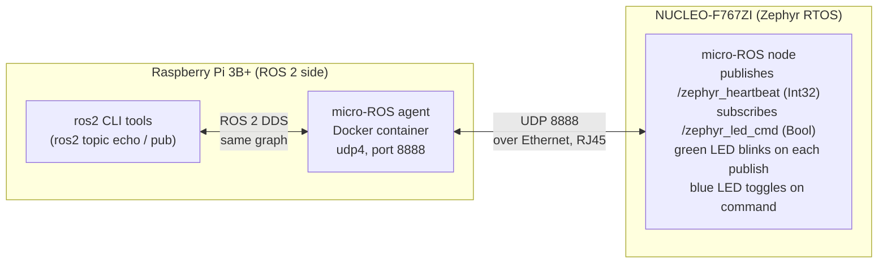

# micro-ROS on Nucleo F767ZI (Zephyr) <-> ROS 2 on Raspberry Pi 3B+

Two projects that talk to each other over **UDP on your LAN**:



| Folder | What it is |
|---|---|
| `nucleo_f767zi_microros/` | Zephyr application + west manifest. Builds `micro_ros_zephyr_module`, uses the **UDP transport** over the board's built-in Ethernet with DHCP. |
| `raspberry_pi_agent/` | ROS 2 side: the micro-ROS **agent** as a Docker service + instructions to inspect/drive topics with ros2 CLI. |

## Topics

| Topic | Type | Direction | Effect |
|---|---|---|---|
| `/zephyr_heartbeat` | `std_msgs/msg/Int32` | Nucleo -> Pi | Counter, published once per second; green LED (LD1, PB0) blinks on each publish |
| `/zephyr_led_cmd` | `std_msgs/msg/Bool` | Pi -> Nucleo | Any received message toggles the blue LED (LD2, PB7) |

## Quick start

1. Flash/prepare the Pi agents: see `raspberry_pi_agent/README.md` (Docker agent on `0.0.0.0:8888`).
2. Find the Pi's IP (`hostname -I` on the Pi) and put it in `nucleo_f767zi_microros/prj.conf` as `CONFIG_MICROROS_AGENT_IP="..."`.
3. Build + flash the Nucleo: see `nucleo_f767zi_microros/README.md` (build in WSL2, flash with STM32CubeProgrammer).
4. Plug both into the same switch/router. On the Pi:
   ```bash
   docker exec microros-agent ros2 topic echo /zephyr_heartbeat
   docker exec microros-agent ros2 topic pub /zephyr_led_cmd std_msgs/msg/Bool "{data: true}"
   ```

## Hardware notes

- **Ethernet**: the Nucleo-144 F767ZI has an onboard RJ45 with PHY (RMII). Connect it to the same LAN as the Pi. PA7 (crs_dv) is used by Ethernet - don't repurpose the Arduino SPI MOSI at the same time.
- **Silicon revision**: board rev. with SoC marking **cut-A** has known Ethernet instability in Zephyr (zephyrproject-rtos/zephyr#26519). Use a cut-Z/rev. Z part if you see flaky links.
- ROS_DOMAIN_ID must match on both sides (default `0`).

## License

Apache-2.0 - see [LICENSE](LICENSE). This demo builds on the micro-ROS Zephyr module
([micro-ROS/micro_ros_zephyr_module](https://github.com/micro-ROS/micro_ros_zephyr_module)), which is Apache-2.0 licensed as well.
